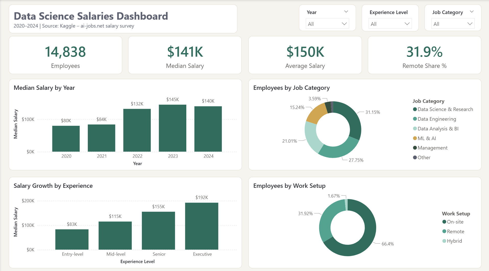
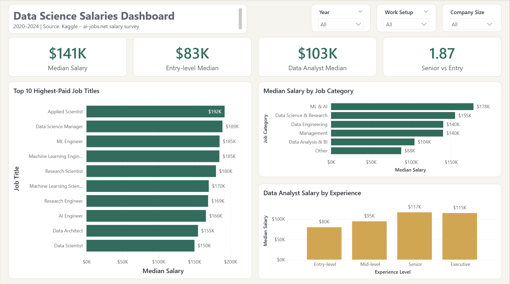
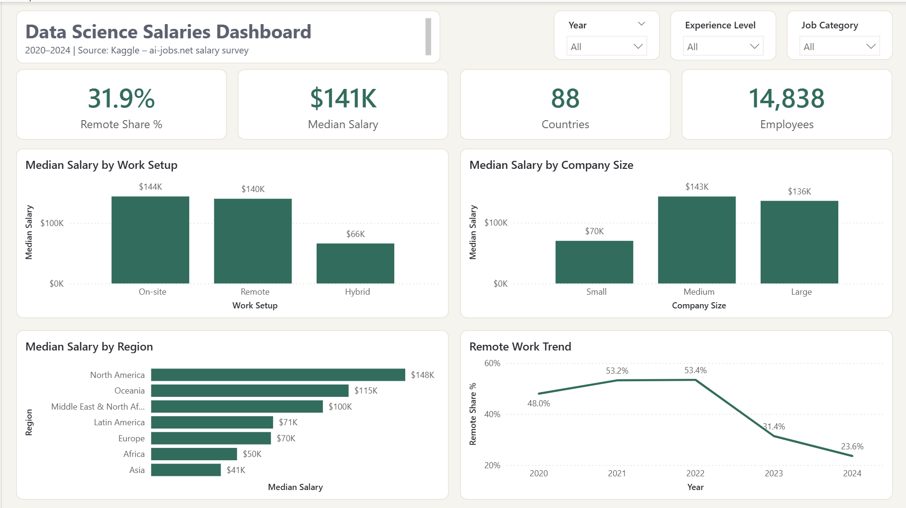

# Data Science Salaries Dashboard | Power BI

A Power BI dashboard analyzing **14,838 real salary records** from data and AI professionals worldwide (2020–2024). It explores how pay changes with experience, role, work setup, company size, and location, with a special focus on the **Data Analyst** role.



---

## Business Questions

1. How much do data professionals earn, and how has pay changed since 2020?
2. How much does experience increase salary?
3. Which roles pay the most, and where does the Data Analyst role stand?
4. Does working remotely, on-site, or hybrid affect pay, and is remote work still growing?
5. How do company size and region affect salary?

---

## Dataset

**Source:** [Data Science Salaries 2024](https://www.kaggle.com/datasets/yusufdelikkaya/datascience-salaries-2024), Kaggle.
The data comes from **ai-jobs.net**, which collects anonymous salary submissions and salaries listed in job postings.

| Column | Description |
|---|---|
| `work_year` | Year the salary was paid |
| `experience_level` | Entry, Mid, Senior, or Executive |
| `job_title` | Role title (153 unique titles) |
| `salary_in_usd` | Annual salary converted to USD |
| `employee_residence` | Employee's country |
| `remote_ratio` | 0 = on-site, 50 = hybrid, 100 = fully remote |
| `company_size` | Small, Medium, or Large |

---

## Data Preparation (Power Query)

| Step | Decision |
|---|---|
| **Removed columns** | Dropped local-currency salary, currency code, and employment type (99.6% full-time), and kept `salary_in_usd` for fair comparison |
| **Readable labels** | Converted codes to clear names, e.g. `SE` → Senior, `M` → Medium |
| **Work setup** | Turned `remote_ratio` (0 / 50 / 100) into a category: On-site, Hybrid, Remote |
| **Job categories** | Grouped 153 job titles into 6 categories using keyword rules: ML & AI, Data Science & Research, Data Engineering, Data Analysis & BI, Management, Other |
| **Countries** | Mapped 90 country codes to country names and regions using a lookup table and a merge |
| **Sort order** | Added an `Experience Order` column so levels sort logically, not alphabetically |
| **Identical rows** | 38% of rows are exact matches. With no employee ID, they may be different people with the same title and pay, so they were **kept**. Removing them changes the median by only ~2% ($141K vs. $138K) |
| **Median over average** | Used the **median** as the main measure because a few very high salaries (up to $800K) pull the average up |

---

## Dashboard Pages

| Page | Focus |
|---|---|
| **Overview** | Headcount, median and average salary, salary trend, job categories, work setup |
| **Experience & Roles** | Salary growth by level, highest-paid titles, job categories, Data Analyst pay |
| **Work Setup & Location** | Remote vs. on-site pay, company size, regions, remote work trend |

| Experience & Roles | Work Setup & Location |
|---|---|
|  |  |

---

## Key Insights

### 1. Salaries rose sharply, then leveled off
The median salary grew from **$80K in 2020 to $145K in 2023**, then held at **$140K in 2024**. Note that 2020 and 2021 have small samples (75 and 218 records), so early figures are less reliable.

### 2. Experience nearly doubles pay
Median pay rises at every level: **$83K (Entry) → $115K (Mid) → $155K (Senior) → $192K (Executive)**. A Senior professional earns **1.87×** an Entry-level one.

### 3. ML & AI roles pay the most, analysis roles the least
**ML & AI** roles lead with a median of **$178K**, while **Data Analysis & BI** sits at **$104K**. The highest-paid individual titles are Applied Scientist, Data Science Manager, and ML Engineer.

### 4. Data Analyst pay grows until Senior level, then plateaus
Data Analysts start at **$80K**, reach **$117K at Senior level**, and stay flat at Executive level ($115K). Growing beyond Senior likely means moving into management or a more technical role.

### 5. Remote work has halved since its peak
The share of fully remote roles peaked at **53% in 2021–2022** and fell to **24% in 2024**, showing a clear return to the office. Remote and on-site roles pay about the same (**$140K vs. $144K**), so working remotely does not mean lower pay.

### 6. Company size and location matter
Small companies pay a median of **$70K**, about half of medium and large companies (~$140K). By region, North America leads at **$148K**, compared with **$70K in Europe** and **$41K in Asia**.

---

## Limitations

- **87% of records are from the United States**, so global and regional results lean heavily toward the US market.
- **Small groups:** Hybrid roles (248 records), small companies (181), and regions outside North America and Europe have few records, so their figures should be read with caution.
- **Self-reported and job-posting data** may not represent every company or country equally.

---

## Tools & Skills

- **Power BI:** Power Query (cleaning, conditional and custom columns, merges), DAX measures, 3-page report with a custom theme
- **Data preparation:** recoding categories, rule-based grouping, lookup tables, handling outliers and duplicates
- **Analysis:** median-based salary analysis, trend analysis, documenting limitations

---

## Repository Structure

```
├── Data_Science_Salaries_Dashboard.pbix
├── README.md
├── data/
│   ├── DataScience_salaries_2024.csv
│   └── country_codes.csv
└── images/
    ├── overview.png
    ├── experience_roles.png
    └── work_setup_location.png
```

---

**Author:** Razan Albishri · [LinkedIn](https://www.linkedin.com/in/razan-albishri)
